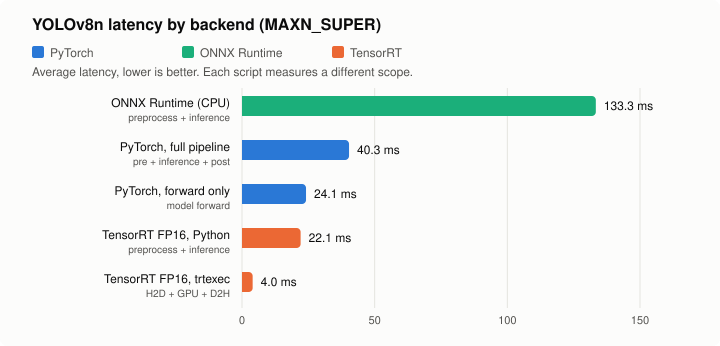
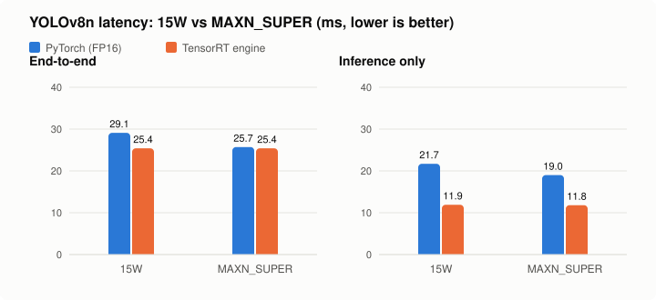
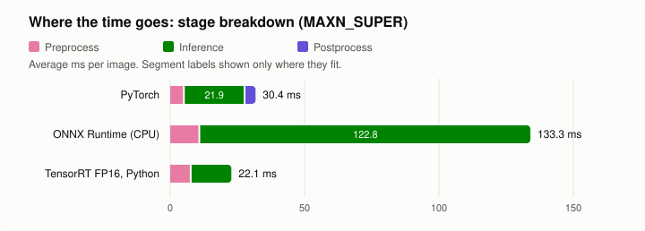
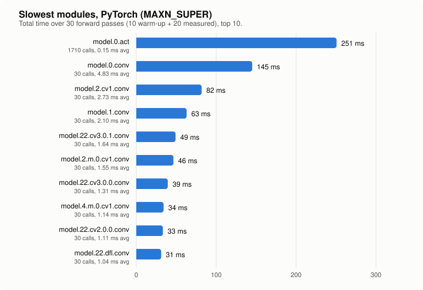
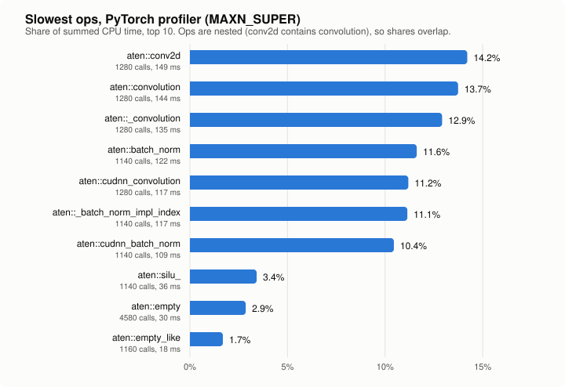

# YOLOv8n Profiling on Jetson Orin Nano

Benchmarking and profiling results for **YOLOv8n** across multiple inference backends on Jetson Orin Nano.

---

## 📁 Project Structure

```
├── yolo_v8/
    ├── 00_onnx_export.py
    ├── 1_single_whole.py
    ├── 2_multiple_whole.py
    ├── 3_3stage_separate.py
    ├── 4_forward_only.py
    ├── 5_module_separate.py
    ├── 6_profiler.py
    ├── 7_onnx_profile.py
    ├── 8_tensorrt_fp16.py
    └── 9_tensorrt_inference.py
```

---

## 🚀 Backend Comparison Summary

> Measured on **MAXN_SUPER** (see [Environment](#️-environment)). Each script measures a different scope, so the rows are not strictly like-for-like. "Previous" is the earlier run of the same scripts; its power mode was not recorded.



| Backend | Avg Latency | Min Latency | Max Latency | FPS | Previous avg |
|---|---|---|---|---|---|
| **PyTorch (Full Pipeline)** | 40.34 ms | 35.92 ms | 47.23 ms | 24.79 | 40.91 ms |
| **PyTorch (Forward Only)** | 24.13 ms | 23.45 ms | 30.99 ms | **41.45** | 28.00 ms |
| **ONNX Runtime (CPU)** | 133.35 ms | 113.76 ms | 320.35 ms | 7.50 | 385.64 ms |
| **TensorRT FP16 (Python, pre + inf)** | 22.09 ms | 20.00 ms | 24.84 ms | 45.27 | — |
| **TensorRT FP16 (trtexec)** | **4.01 ms** | 3.69 ms | 5.57 ms | **288.2 qps** | 6.12 ms |

> ✅ TensorRT FP16 (trtexec) is **~6.0× faster** than PyTorch forward-only, and **~33× faster** than ONNX Runtime.
> ⚠️ The Python TensorRT script (22.1 ms) is far slower than trtexec (4.0 ms): it adds 7.3 ms of preprocessing, and its 14.8 ms "inference" includes host copies and Python overhead (cause not profiled).

---

## 🎬 Video Benchmark: Power Mode & TensorRT

End-to-end test on a video file (`predict()` per frame, including pre/post-processing), comparing PyTorch (FP16) vs. TensorRT engine under two `nvpmodel` power modes.



| Model | Metric | 15W | MAXN_SUPER | Diff |
|---|---|---|---|---|
| `yolov8n.pt` (FP16) | End-to-end | 29.1 ms (34.4 FPS) | 25.7 ms (39.0 FPS) | MAXN_SUPER ~13% faster |
| `yolov8n.pt` (FP16) | Inference only | 21.7 ms | 19.0 ms | ~12% faster |
| `yolov8n.engine` (TensorRT) | End-to-end | 25.4 ms (39.4 FPS) | 25.4 ms (39.3 FPS) | no difference |
| `yolov8n.engine` (TensorRT) | Inference only | 11.9 ms | 11.8 ms | no difference |

**Takeaways**
*   TensorRT cuts pure inference time by ~1.6x (19.0 → 11.8 ms on MAXN_SUPER), but end-to-end time barely changes because CPU-side pre/post-processing (~14 ms) dominates.
*   PyTorch benefits from MAXN_SUPER (~12-13%), while the TensorRT engine runs the same in 15W and MAXN_SUPER. For a small model like YOLOv8n, 15W is enough, with roughly half the power and heat.
*   These numbers come from a different script and input than the tables below (`trtexec` / profiler runs), so they are not directly comparable with them.

**Setup:** Jetson Orin Nano 8GB Super, JetPack 6.2.1 (L4T R36.4.7), CUDA 12.6, TensorRT 10.3, rootfs on NVMe SSD, `jetson_clocks` off.
Input: `videos/person-bicycle-car-detection.mp4` (768x432), 300 frames, 20 warm-up frames. Single run per mode (expect about ±1 ms noise).

**Reproduce** (from the repository root)
```bash
sudo nvpmodel -m 0   # 15W  (-m 2 for MAXN_SUPER)
PYTHONPATH=~/trt_shim python src/bench_yolo.py yolov8n.pt yolov8n.engine \
    --source videos/person-bicycle-car-detection.mp4 | tee runs/bench_15w.log
python src/yolo_v8/plot_bench.py   # regenerate the chart from runs/bench_*.log
```
Raw logs: [`runs/bench_15w.log`](../../runs/bench_15w.log), [`runs/bench_maxn_super.log`](../../runs/bench_maxn_super.log) · Scripts: [`src/bench_yolo.py`](../bench_yolo.py), [`plot_bench.py`](plot_bench.py)

---

## 📊 PyTorch Stage-wise Breakdown

> Full pipeline: preprocess → inference → postprocess



| Stage | Avg | Min | Max | Ratio |
|---|---|---|---|---|
| Preprocess | 4.76 ms | 4.54 ms | 5.03 ms | 15.65% |
| **Inference** | **21.90 ms** | 19.19 ms | 29.94 ms | **71.98%** |
| Postprocess | 3.76 ms | 3.60 ms | 4.27 ms | 12.38% |
| **Total** | **30.42 ms** | 27.45 ms | 38.97 ms | 100% |

---

## 🔬 ONNX Runtime Breakdown

| Stage | Avg | Min | Max |
|---|---|---|---|
| Preprocess | 10.50 ms | 7.61 ms | 18.42 ms |
| **Inference** | **122.85 ms** | 105.29 ms | 303.45 ms |
| **Total** | **133.35 ms** | 113.76 ms | 320.35 ms |

> ⚠️ The installed `onnxruntime` only offers `CPUExecutionProvider` (providers: `AzureExecutionProvider`, `CPUExecutionProvider`), so the whole model runs on the CPU, not just a few fallback ops. Variance is high (105 ms ~ 303 ms).

---

## ⚡ TensorRT FP16 Result

**trtexec** (engine only, CUDA Graph, 200 iterations)

| Metric | Value |
|---|---|
| Mean Latency (H2D + GPU + D2H) | 4.01 ms |
| GPU Compute Time | 3.46 ms |
| H2D / D2H | 0.32 ms / 0.24 ms |
| Throughput | 288.2 qps |

**Python** (`9_tensorrt_inference.py`, `bus.jpg`, 100 iterations)

| Stage | Avg | Min | Max |
|---|---|---|---|
| Preprocess | 7.30 ms | 5.48 ms | 10.00 ms |
| Inference | 14.79 ms | 14.53 ms | 15.42 ms |
| **Total** | **22.09 ms** | 20.00 ms | 24.84 ms |

> `9_tensorrt_inference.py` needs `cuda-python` 12.x on JetPack 6.2 (CUDA 12.6 driver). `cuda-python` 13.x fails with `cudaErrorInsufficientDriver`.

**Build command:**
```bash
trtexec \
  --onnx=yolov8n.onnx \
  --saveEngine=engines/yolov8n_fp16.engine \
  --fp16 \
  --memPoolSize=workspace:4096 \
  --verbose
```

**Benchmark command:**
```bash
trtexec \
  --loadEngine=engines/yolov8n_fp16.engine \
  --warmUp=100 \
  --iterations=200 \
  --useCudaGraph
```

---

## 🧩 Module-wise Profiling (Top 20, sorted by total time)



> Hooks were registered before warm-up, so each module's 30 calls include the 10 warm-up passes.

| Module | Avg (ms) | Total (ms) | Calls |
|---|---|---|---|
| model.0.act | 0.147 | 250.630 | 1710 |
| model.0.conv | 4.835 | 145.049 | 30 |
| model.2.cv1.conv | 2.725 | 81.747 | 30 |
| model.1.conv | 2.100 | 63.000 | 30 |
| model.22.cv3.0.1.conv | 1.637 | 49.112 | 30 |
| model.2.m.0.cv1.conv | 1.549 | 46.472 | 30 |
| model.22.cv3.0.0.conv | 1.314 | 39.426 | 30 |
| model.4.m.0.cv1.conv | 1.139 | 34.158 | 30 |
| model.22.cv2.0.0.conv | 1.109 | 33.276 | 30 |
| model.22.dfl.conv | 1.037 | 31.106 | 30 |
| model.7.conv | 1.007 | 30.222 | 30 |
| model.4.m.1.cv1.conv | 0.981 | 29.434 | 30 |
| model.4.m.1.cv2.conv | 0.980 | 29.408 | 30 |
| model.22.cv2.0.1.conv | 0.980 | 29.392 | 30 |
| model.4.m.0.cv2.conv | 0.974 | 29.222 | 30 |
| model.15.m.0.cv1.conv | 0.968 | 29.040 | 30 |
| model.15.m.0.cv2.conv | 0.966 | 28.972 | 30 |
| model.3.conv | 0.896 | 26.874 | 30 |
| model.22.cv2.1.0.conv | 0.883 | 26.484 | 30 |
| model.9.m | 0.274 | 24.662 | 90 |

---

## 🔥 Op-wise Profiling — Top 15 (CPU time domain)



| Op | Time (ms) | Ratio | Calls |
|---|---|---|---|
| aten::conv2d | 148.802 | 14.21% | 1280 |
| aten::convolution | 143.964 | 13.74% | 1280 |
| aten::_convolution | 135.367 | 12.92% | 1280 |
| aten::batch_norm | 121.728 | 11.62% | 1140 |
| aten::cudnn_convolution | 117.245 | 11.19% | 1280 |
| aten::_batch_norm_impl_index | 116.661 | 11.14% | 1140 |
| aten::cudnn_batch_norm | 109.467 | 10.45% | 1140 |
| aten::silu_ | 35.789 | 3.42% | 1140 |
| aten::empty | 29.941 | 2.86% | 4580 |
| aten::empty_like | 17.726 | 1.69% | 1160 |
| aten::cat | 14.630 | 1.40% | 340 |
| aten::chunk | 6.513 | 0.62% | 180 |
| aten::add | 6.052 | 0.58% | 160 |
| aten::split | 5.705 | 0.54% | 180 |
| aten::view | 5.479 | 0.52% | 1420 |

---

## 🎯 Optimization Targets (Priority Order)

### 1순위 — Conv + BN Fusion
| Op | Time (ms) | Ratio |
|---|---|---|
| `aten::cudnn_convolution` | 117.245 ms | 11.19% |
| `aten::cudnn_batch_norm` | 109.467 ms | 10.45% |

→ Conv-BN fusion (e.g., `torch.fx` or TensorRT graph optimization) 으로 직접 절감 가능

### 2순위 — Activation
| Op | Time (ms) | Ratio |
|---|---|---|
| `aten::silu_` | 35.789 ms | 3.42% |

→ SiLU → ReLU 교체 or fused kernel 적용 검토

### 3순위 — Memory Allocation
| Op | Time (ms) | Ratio |
|---|---|---|
| `aten::empty` | 29.941 ms | 2.86% |
| `aten::empty_like` | 17.726 ms | 1.69% |
| `aten::cat` | 14.630 ms | 1.40% |

→ 잦은 메모리 할당 → pre-allocated buffer / in-place op 활용 권장

---

## 🖥️ Environment

| Item | Detail |
|---|---|
| Device | Jetson Orin Nano 8GB Super |
| Power mode | MAXN_SUPER (`nvpmodel -m 2`), `jetson_clocks` off |
| Software | JetPack 6.2.1 (L4T R36.4.7), CUDA 12.6, TensorRT 10.3, PyTorch 2.10 |
| Model | YOLOv8n |
| TensorRT Precision | FP16 |
| CUDA Graph | Enabled (trtexec) |
| Input | `bus.jpg` (scripts 2, 3, 7, 9) / random 1×3×640×640 tensor (scripts 4, 5, 6) |

**Reproduce** (from the repository root; raw logs are in `runs/bench_maxn_super_*.log`)
```bash
python src/yolo_v8/2_multiple_whole.py        # also 3_3stage_separate, 4_forward_only, 5_module_separate, 6_profiler, 7_onnx_profile
PYTHONPATH=~/trt_shim python src/yolo_v8/9_tensorrt_inference.py   # needs cuda-python 12.x
python src/yolo_v8/plot_profile.py            # regenerate the charts from the logs
```
